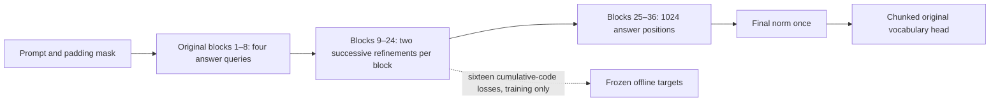

# Native embedded architecture

The default configuration is `configs/architecture/embedded_1024.yaml`, with a
384-wide continuous stream, four initial queries, 36 original Qwen blocks, and
32 sequential hierarchy updates. It is an initial engineering design, not an
established optimum or evidence of a semantic concept hierarchy.



The 32 resolutions are:

```text
4,5,6,7,8,10,12,14,17,20,24,29,34,41,49,59,
70,84,100,120,143,171,205,245,293,350,419,501,599,716,856,1024
```

They are `round(4*256**(i/31))`, i=0..31. The initial queries do not count as a
33rd update. One-based block 9 (zero-based index 8) is followed by updates 1/2;
block 24 (index 23) by updates 31/32. The next original block consumes the updated
stream. Actual hidden tensors grow physically; there is no concealed full-canvas
answer stream in early blocks. Tiny tests also execute the complete 32/1024 geometry.

For each update, deterministic interval-overlap resize produces `h_base,z_base`.
A group-specific down projection, position projection, level embedding, and small
latent MLP predict a refinement. With a nonzero gate initially 0.1:

```text
z_next = z_base + gate * delta
h_next = h_base + up(gate * delta)
```

The down/up projections and refinement network are shared within a two-update
group; all 32 operations still execute. Projection outputs and gates are not both
zero-initialized. Original attention and MLP residual paths are unchanged. Longer
skips are disabled; enabling them is rejected pending an explicit implementation.

At n positions, slot j covers `[floor(j*C/n),floor((j+1)*C/n))`. Resize weights are
normalized interval overlaps and use at most O(source+destination) edges, not a
hidden full-width C-position copy. RoPE answer positions are the integer interval
center `floor((left+right-1)/2)` plus valid prompt length. Prompt positions are the
cumulative valid-token indices. Geometry features encode canvas position, span,
level, and prompt length; they never encode true answer length.

Every original block receives an explicit additive SDPA mask: prompt queries see
only causal valid prompt tokens; answer queries see all valid prompt tokens and
current answer states; prompt-to-answer attention is blocked. Padded prompt query
rows are fully masked and then zeroed. The whole sequence is never silently marked
causal. Actual SDPA kernel fallback/memory requires hardware measurement.

`forward(prompt_input_ids,prompt_attention_mask,return_aux=False)` returns normalized
answer states and optionally sixteen cumulative codes. Labels and targets are not
accepted. Final CE aligns slot t to answer token t without a stock AR shift.
Vocabulary projection is chunked/checkpointed for exact training CE and chunked
argmax for inference. Backward activation recomputation is separate from the
single logical inference traversal. Ordinary autoregressive KV reuse is disabled.

Offline codec targets are one shared encoder representation pooled at each scale.
Residual targets telescope under the same resize rule; the generator losses compare
cumulative codes after even updates. No target code is injected into later groups.
Only deployed Qwen/query/refinement weights and the tokenizer enter inference.
