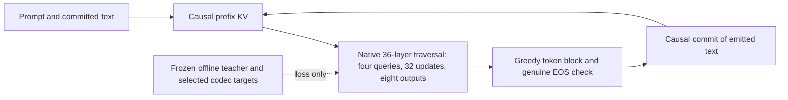

# Hierarchical eight-token continuation design — 2026-11-09

The user explicitly replaces the custom masked-block baseline with a semi-AR
version of the native embedded hierarchy. The old implementation is removed from
active code; its Git commit and dated validation receipt remain historical evidence.
This plan is implemented and checked by bounded software fixtures, not a production
training or model-quality claim.

## Fixed model contract

Use pinned original Qwen3-8B and the canonical native xsmall/eight-position
architecture: 8/16/12 original blocks, four learned initial queries, width 384,
32 physical hierarchy updates, 16 cumulative-code losses, fixed interval-overlap
resize and integer-center RoPE. Each active block starts from fresh learned queries
and zero compact state. Its prediction sees only the rendered conversation and
preceding committed text. No current-block token, remaining length/mask, teacher
state or target code is a generator forward input.

Infer eight tokens together with one original-backbone traversal. Trim only at a
predicted genuine EOS. Otherwise append the final eight text tokens to context and
repeat up to explicit token/block/context caps. No mask token, diffusion unmasking,
drafter, verifier, token-AR correction, or recurrent gold code is supplied.

## Research-informed adaptations and deliberate boundaries

[SDAR](https://arxiv.org/abs/2510.06303) supports left-to-right block generation and
KV reuse from committed blocks. [NBDiff](https://arxiv.org/abs/2512.06776) motivates
preserving strict causal attention in committed context and auxiliary AR supervision
when adapting a pretrained AR model. We adopt those conditioning principles, while
replacing diffusion with this repository's native hierarchy. This is not a
reproduction of either released model, and neither is called an implemented baseline.

Keep committed prompt/text KVs separate from transient hierarchy answer states.
At each Qwen layer, active hierarchy queries read immutable causal prefix KVs and
current answer KVs. Prefix queries cannot read answer states. After emission,
recompute KVs from actual text under causal attention. Test equality against full
uncached native forward at every hierarchy scale and after multiple commits.

A 1/2-token curriculum contradicts four nonempty initial hierarchy queries and is
removed. Block size stays eight. Preserve native CE + 0.1 mean cumulative-code loss;
add explicitly weighted shifted AR CE (default 0.1) as a separate training-only
causal traversal. It is not an inference repair. Fixed-size geometry and all updates
remain mandatory. Codec and generator schedules/horizons are separate and explicit.

## Preparation and stage contracts

Source -> parent/offset preparation -> frozen original teacher features -> codec
training/selection -> frozen fine-code targets -> full-backbone generator
training/selection -> locked full-answer rollouts. Execution is explicit and default
planning starts none of these stages. Existing approved Tulu and sealed tokenized
source support, whole-group splits, licenses, exact original references, genuine
EOS and bounded indexes are retained.

Teacher extraction operates once per complete parent answer. Prediction state
P-1+t supervises answer token t. A block at offset k uses states k:k+8, exactly
matching extraction with context prompt+answer[:k]. Only a bounded, deterministic
train/dev subset is retained for fitting the shared native codec. Test parents
never enter teacher/codec/statistics/target fitting. Whole-parent subset admission
and actual positions are recorded; repeated blocks are not unique new answers.

Codec training uses native reconstruction MSE and frozen-head consistency losses
at the fixed eight-position geometry. Normalization and channel scales use explicit
fixed training-only view subsets; dev selects weights. Targets stream the complete
train/dev pool through frozen teacher and selected FP32 codec, retaining fine codes
once per parent. Pooling and residual geometry are applied within each block, never
across answer blocks. No teacher or codec is loaded during generator training.

## Integrity, resources and validation

Use new schema/family identities for config, data, caches, codec, recovery and
selected generator export. Reject custom-baseline configs/exports/recoveries rather
than migrate their labels. Keep historical failed runs/configurations/ledgers.
Each stage has finite per-attempt/phase work, retained storage, cumulative writes,
wall clocks (enabled by default), retry caps and disk admission. Admission inventories
the actual hierarchy, codec and frozen teacher/head separately. Release stage-local
model references and allocator caches between stages; full-8B peaks remain unmeasured.

Test actual eight-position/four-query tensors, all 32 updates/16 losses/36 layers,
mask/position geometry, cached-vs-uncached equivalence, P-1+t teacher alignment,
codec target telescoping/freeze, EOS at all positions and longer rollouts, dataset
split/offset integrity, stage failures, old-schema rejection, selected export
corruption, and exact interrupted/resumed codec and generator updates. Run the
complete repository pytest suite, ruff and a bounded tiny CUDA check when available.
